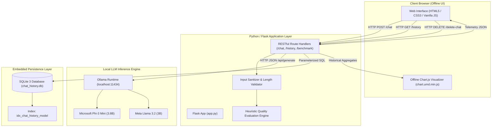
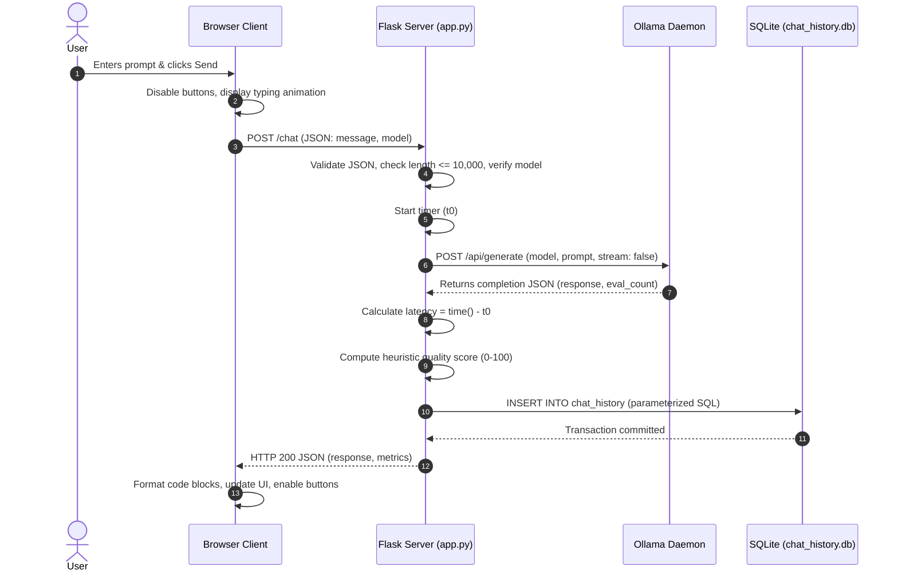

# 🏛️ System Architecture - Offline AI Assistant

This document outlines the technical design, architectural patterns, component interactions, and data flow pipelines of the **Offline AI Assistant**.

---

## 1. Architectural Principles

1. **Air-Gapped & Zero-Cloud:** No external network requests are permitted. All libraries, models, and assets reside on `localhost`.
2. **Layered Separation of Concerns:** Clear demarcation between Presentation (HTML/CSS/JS), Business Logic (Flask), Inference (Ollama), and Persistence (SQLite).
3. **Fail-Safe & Non-Destructive Operations:** Database interactions are transactional (`commit` / `rollback`), connections safely closed in `finally` blocks, and user actions (such as clear screen) never destroy stored data.
4. **Empirical Telemetry:** Every inference cycle collects concrete hardware telemetry (latency, token output, text volume).

---

## 2. High-Level Architecture Diagram

---

## 3. Component Hierarchy

### A. Presentation Layer (`templates/` & `static/`)
- **`index.html`**: Dual-model chat interface with smooth auto-scrolling, code syntax blocks, dynamic suggestion pills, and responsive mobile adaptations.
- **`history.html`**: Instant client-side search, model filtering, chronological sorting, and discrete prompt vs. completion message containers.
- **`benchmark.html`**: Statistical evaluation cards and four interactive Bar charts analyzing response latency, tokens, characters, and heuristic scores.
- **`static/js/chart.umd.min.js`**: Bundled offline Chart.js engine.

### B. Application & Routing Layer (`app.py`)
- **Route Orchestration**: Directs requests between views, APIs, and the inference engine.
- **Validation Engine**: Rejects non-dictionary JSON payloads, non-string messages, invalid model strings, and inputs $> 10,000$ characters.
- **Heuristic Quality Evaluator**: Algorithmic assessment calculating prompt overlap, structural length, and error absence.
- **Information Leakage Barrier**: Sanitizes exception traces to prevent local machine filesystem disclosure.

### C. Inference Engine Layer (Ollama)
- Communicates over local loopback (`http://localhost:11434/api/generate`).
- Configured with a `120s` timeout to accommodate cold-start model loading into memory.
- Extracts `eval_count` for precise token accounting with word count approximation fallbacks.

### D. Persistence Layer (`database/chat_history.db`)
- Uses SQLite with thread timeout protection (`timeout=10.0`).
- Automated schema migrations via `init_db()` ensure backward compatibility across version updates.
- Performance indexed on `model` column (`idx_chat_history_model`).

---

## 4. End-to-End Request Lifecycle (`POST /chat`)

---

## 5. Telemetry & Benchmark Pipeline

To prevent metric corruption caused by legacy rows or missing fields, metrics on the Benchmark Dashboard undergo strict mathematical filtering:

$$\text{Valid Records } S = \{ r \in \text{Records} \mid r.\text{metric} \neq \text{NULL} \land r.\text{metric} \neq \text{NaN} \land r.\text{metric} > 0 \text{ (for tokens)} \}$$

$$\text{Empirical Average} = \begin{cases} 
\frac{1}{|S|} \sum_{r \in S} r.\text{metric} & \text{if } |S| > 0 \\ 
0 & \text{if } |S| = 0 
\end{cases}$$

This guarantees that:
- Historical unmetered records (where `token_count` defaulted to `0`) do not distort average token metrics.
- Unsuccessful runs (which do not insert a database row) do not affect baseline statistics.

---

## 6. Security & Defense Matrix

| Attack Vector | Defense Mechanism | Implementation Detail |
| :--- | :--- | :--- |
| **SQL Injection (SQLi)** | Parameterized Bindings | All `SELECT`, `INSERT`, `DELETE` queries use `?` bind parameters. Sort direction is restricted to an explicit `asc` / `desc` whitelist. |
| **Cross-Site Scripting (XSS)** | String Escaping | Client-side `escapeHtml()` parses and escapes all raw strings (`&`, `<`, `>`, `"`, `'`) before DOM injection. |
| **Denial of Service (DoS)** | Input Bounding | Prompts are capped at 10,000 characters; HTTP client implements a 120-second timeout. |
| **Information Disclosure** | Error Sanitization | Internal OS paths, stack traces, and database exceptions are logged server-side and obscured in user-facing JSON. |
| **Data Loss Prevention** | Transaction Isolation | UI clear actions are strictly client-side DOM resets; SQLite records require explicit, individual deletion with user confirmation. |
